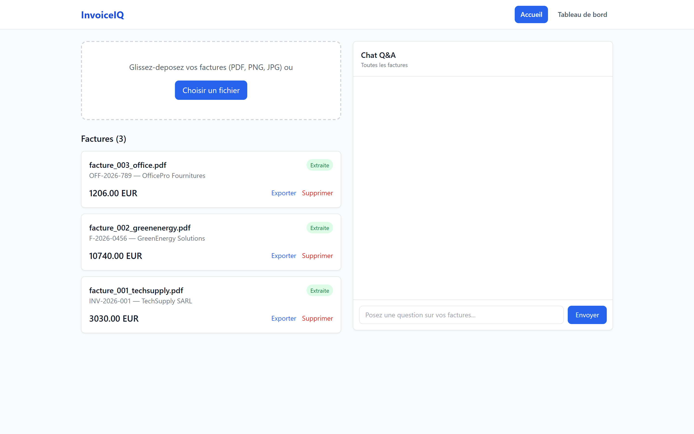
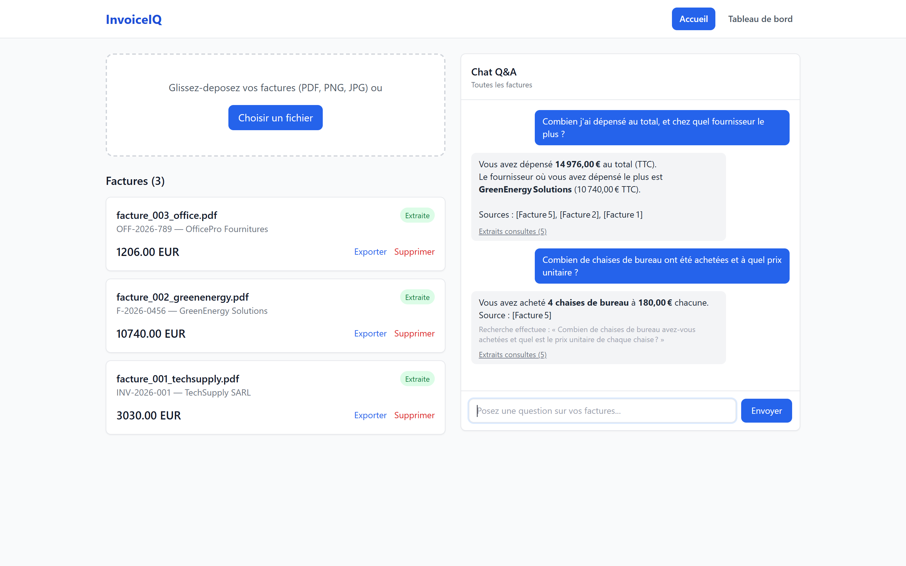
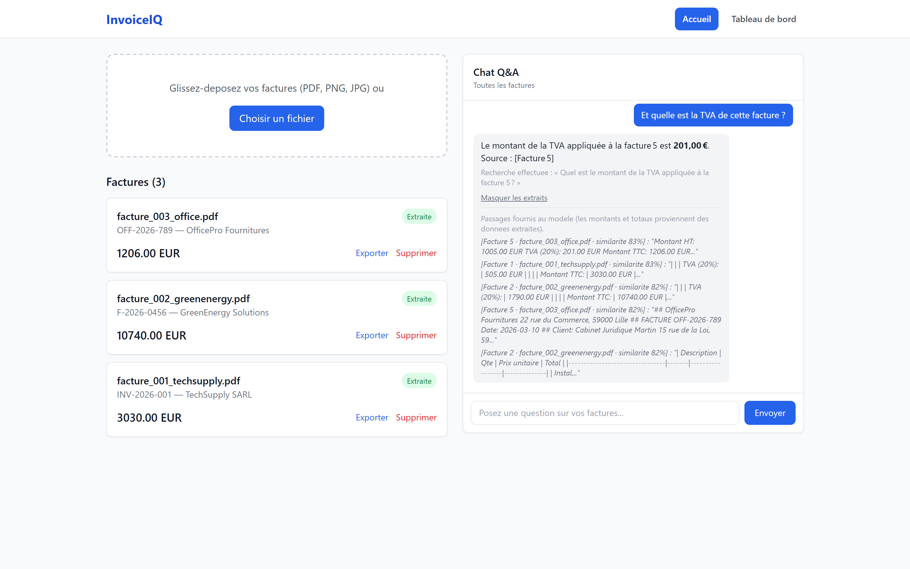
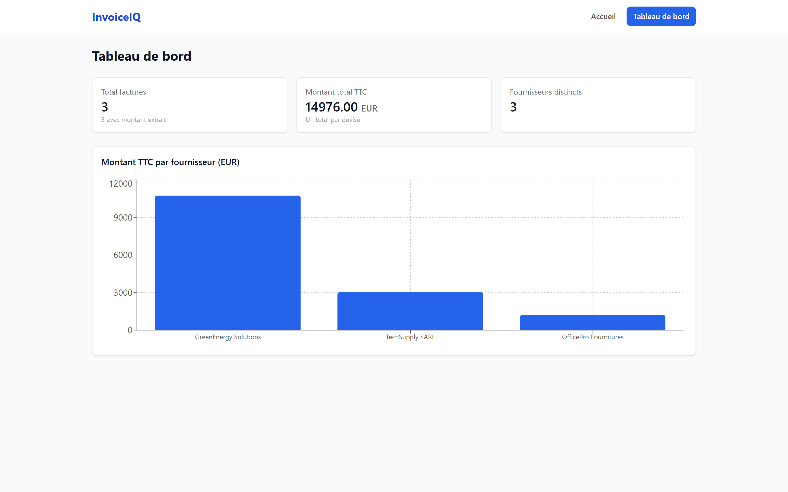
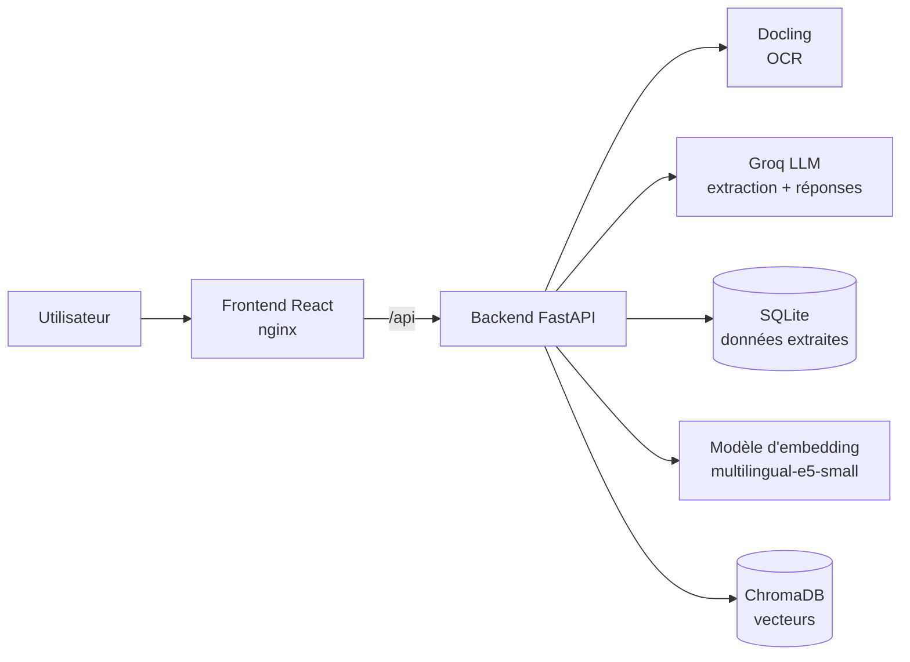

# InvoiceIQ

**Extraction intelligente et interrogation de factures en langage naturel.**

InvoiceIQ lit des factures (PDF natifs, PDF scannés, images), en extrait automatiquement les informations clés (numéro, date, fournisseur, client, montants HT / TVA / TTC, devise), vérifie leur cohérence comptable, puis permet de poser des questions en français sur l'ensemble des factures via un chat.

> *« Combien j'ai dépensé au total, et chez quel fournisseur le plus ? »* → **14 976,00 € TTC, dont 10 740,00 € chez GreenEnergy Solutions**

---

## Sommaire

1. [Aperçu](#aperçu)
2. [Fonctionnalités](#fonctionnalités)
3. [Architecture](#architecture)
4. [Les notions clés expliquées](#les-notions-clés-expliquées)
5. [Rôle de chaque partie du code](#rôle-de-chaque-partie-du-code)
6. [Installation et lancement](#installation-et-lancement)
7. [Utilisation](#utilisation)
8. [API](#api)
9. [Évaluation et résultats](#évaluation-et-résultats)
10. [Limites et pistes d'amélioration](#limites-et-pistes-damélioration)

---

## Aperçu

### Factures importées et extraites
Chaque facture déposée est lue (OCR), ses champs sont extraits et contrôlés. Le statut indique si l'extraction a réussi ou si la facture doit être vérifiée.



### Questions en langage naturel
Les totaux sont calculés de façon exacte à partir des données extraites ; les questions de détail (articles, adresses…) sont résolues en cherchant dans le texte des factures.



### Question de suivi et extraits consultés
« cette facture » est compris grâce à l'historique (reformulé en « facture 5 »). Les passages utilisés pour répondre sont affichés avec leur score de similarité.



### Tableau de bord
Totaux par devise et par fournisseur, calculés côté serveur.



---

## Fonctionnalités

| Fonctionnalité | Description |
|---|---|
| Upload | PDF, PNG, JPG (glisser-déposer, plusieurs fichiers), détection des doublons par empreinte du contenu |
| OCR / IDP | Lecture du texte et de la mise en page avec Docling, y compris pour les scans et les photos |
| Extraction structurée | N° de facture, date, fournisseur, client, HT, montant TVA, taux TVA, TTC, devise |
| Contrôles de cohérence | HT + TVA = TTC, HT × taux = TVA, champs manquants → statut « À vérifier » avec la liste des anomalies |
| Indexation vectorielle | Découpage en passages, embeddings multilingues, stockage dans ChromaDB |
| Chat | Questions en français (ou en anglais), totaux exacts, détails par RAG, historique et questions de suivi |
| Sources | Affichage des passages consultés avec leur score de similarité |
| Multi-factures | Interroger toutes les factures ou seulement celles sélectionnées |
| Export | Export JSON des données d'une facture |
| Tableau de bord | Nombre de factures, totaux par devise, montants par fournisseur |
| Évaluation | Script qui mesure la qualité de l'extraction et de la recherche |

---

## Architecture



### Le parcours d'une facture

```
1. Upload            Le fichier est enregistré sous un nom unique ; un doublon exact est refusé.
        │
2. OCR (Docling)     Le document est converti en texte (Markdown, tableaux conservés).
        │
3. Extraction (LLM)  Le texte est envoyé au LLM qui renvoie un JSON des champs.
        │            → validation (formats français, dates ISO, devises)
        │            → contrôles comptables (HT + TVA = TTC…) → statut « Extraite » ou « À vérifier »
        │            → stockage dans SQLite
        │
4. Indexation        Le texte est découpé en passages (chunks) ; chaque passage reçoit un en-tête
                     (fichier, fournisseur, n°, date), est transformé en vecteur et stocké dans ChromaDB.
```

### Le parcours d'une question

```
1. Reformulation     Si la question dépend de l'historique (« et sa TVA ? »), le LLM la réécrit
        │            en question autonome (« Quelle est la TVA de la facture 5 ? »).
        │
2. Recherche         La question est vectorisée ; ChromaDB renvoie les passages les plus proches
        │            (similarité cosinus, au-dessus d'un seuil minimal).
        │
3. Données exactes   Le tableau des factures et les agrégats (totaux par devise, par fournisseur,
        │            par mois) sont calculés en Python à partir de SQLite.
        │
4. Génération        Le LLM reçoit passages + tableau + agrégats et répond UNIQUEMENT à partir
                     de ces éléments, en citant les factures utilisées [Facture id].
```

---

## Les notions clés expliquées

### OCR et IDP
L'**OCR** (*Optical Character Recognition*) transforme l'image d'un document en texte. L'**IDP** (*Intelligent Document Processing*) va plus loin : il reconnaît aussi la structure (titres, tableaux, colonnes). InvoiceIQ utilise **Docling** (IBM, open source), qui produit du Markdown en conservant les tableaux, ce qui aide le LLM à associer chaque montant à son libellé.

### LLM et extraction structurée
Un **LLM** (*Large Language Model*) est un modèle capable de comprendre et de produire du texte. Ici, il sert d'abord d'**extracteur** : on lui donne le texte brut de la facture et des consignes précises, et il renvoie un objet JSON avec des champs définis à l'avance. Le modèle est appelé via **Groq** (`openai/gpt-oss-20b` par défaut) avec une température de 0 pour des réponses stables.

### Validation et contrôles de cohérence
Un LLM peut se tromper : confondre le taux de TVA (20) avec son montant (505 €), mal lire un nombre au format français (`1 380,00`), inventer une devise. Sa sortie n'est donc jamais acceptée telle quelle :
- **Validation** (Pydantic) : conversion des nombres et des dates, codes devise ISO.
- **Contrôles comptables** : HT + TVA = TTC, HT × taux = TVA, montants négatifs, taux invraisemblables.
- Toute incohérence marque la facture **« À vérifier »** et liste les anomalies au lieu de présenter une donnée fausse comme fiable.

### Chunking (découpage)
Un document est découpé en **passages** (*chunks*) d'environ 500 caractères, avec un chevauchement de 100 caractères pour ne pas couper une information en deux. Chaque passage reçoit un **en-tête** (fichier, fournisseur, numéro, date) : sans lui, un passage comme « Montant TTC : 3030 EUR » ne dirait pas à quelle facture il appartient.

### Embeddings
Un **embedding** est une représentation d'un texte sous forme de vecteur de nombres (ici 384 dimensions). Deux textes de sens proche ont des vecteurs proches, même s'ils n'utilisent pas les mêmes mots. Le modèle **`intfloat/multilingual-e5-small`** est multilingue : les factures et les questions étant en français, un modèle entraîné surtout en anglais donnerait une recherche nettement moins bonne.

### Base vectorielle et similarité cosinus
**ChromaDB** stocke les vecteurs et retrouve rapidement les plus proches d'une question. La proximité est mesurée par la **similarité cosinus** (de 0 à 1 : plus c'est haut, plus les sens sont proches). Le score affiché dans l'interface est cette similarité.

### RAG (Retrieval-Augmented Generation)
Le **RAG** consiste à **chercher** d'abord les passages pertinents dans les documents, puis à les **donner** au LLM pour qu'il **génère** une réponse fondée uniquement sur eux. Cela limite les inventions (hallucinations) et permet de citer les sources.

### Pourquoi les totaux ne passent pas par le RAG
Le RAG ne fournit au LLM que les *k* passages les plus proches (5 par défaut). Pour une question comme « combien j'ai dépensé au total ? », il ne verrait qu'une partie des factures, et un LLM additionne mal. Les **agrégats** (totaux par devise, par fournisseur, par mois) sont donc **calculés en Python** à partir des données extraites, puis transmis tels quels au LLM. On n'additionne jamais deux devises différentes.

### Reformulation des questions de suivi
Dans « et quelle est la TVA de cette facture ? », « cette facture » n'a de sens qu'avec l'historique. Avant la recherche, le LLM réécrit la question en version autonome ; c'est cette version qui est vectorisée. Elle est affichée sous la réponse (« Recherche effectuée : … »).

### Évaluation : exactitude, recall@k, MRR
- **Exactitude par champ** : part des champs extraits identiques à la vérité terrain (montants à ±0,01 près).
- **Recall@k** : part des questions pour lesquelles la bonne facture figure parmi les *k* premiers passages retrouvés.
- **MRR** (*Mean Reciprocal Rank*) : moyenne de 1/rang du premier passage pertinent (1,0 = toujours classé premier).

---

## Rôle de chaque partie du code

### Backend (`backend/`) — FastAPI, Python 3.11

| Fichier | Rôle |
|---|---|
| `main.py` | Point d'entrée de l'API : routes, CORS, initialisation de la base, ré-indexation automatique au démarrage si la collection vectorielle est vide |
| `config.py` | Tous les paramètres (modèles, ChromaDB, chunking, seuils), lus depuis `.env` |
| `routers/upload.py` | Upload (contrôle d'extension et de taille, doublons, nom de fichier sécurisé), liste, détail, suppression, export JSON, `/stats`, `/reindex` |
| `routers/extract.py` | Relance de l'extraction structurée d'une facture |
| `routers/chat.py` | Point d'entrée du chat, gestion des erreurs du LLM (clé invalide…) |
| `services/pipeline.py` | Orchestration : OCR → extraction → indexation |
| `services/ocr_service.py` | Conversion du document en texte avec Docling (repli `pypdf` pour les PDF natifs) |
| `services/extractor.py` | Prompt d'extraction, appel au LLM, validation et contrôles comptables |
| `services/chunker.py` | Découpage du texte en passages et ajout de l'en-tête contextuel |
| `services/embedder.py` | Calcul des embeddings (préfixes `query:` / `passage:` propres aux modèles E5, vecteurs normalisés) |
| `services/vectorstore.py` | Indexation et recherche dans ChromaDB (distance cosinus, filtre par facture, seuil de score) |
| `services/analytics.py` | Agrégats exacts (par devise, fournisseur, mois) et mise en forme pour le LLM |
| `services/rag_service.py` | Chat complet : nettoyage de l'historique, reformulation, recherche, construction du prompt, réponse |
| `models/schemas.py` | Schémas Pydantic : validation des données extraites, des requêtes et des réponses |
| `database/db.py` | Accès SQLite et migration automatique du schéma |
| `eval/` | Script d'évaluation, vérité terrain et questions de test |

### Frontend (`frontend/`) — React, TailwindCSS, Recharts

| Fichier | Rôle |
|---|---|
| `src/api.js` | Appels à l'API backend (axios) |
| `src/App.jsx` | Navigation entre Accueil et Tableau de bord |
| `src/pages/Home.jsx` | Page principale : upload, liste des factures, chat |
| `src/pages/Dashboard.jsx` | Indicateurs et graphique des montants par fournisseur |
| `src/components/UploadZone.jsx` | Zone de glisser-déposer, upload de plusieurs fichiers, messages d'erreur |
| `src/components/InvoiceCard.jsx` | Carte d'une facture : statut, badge « À vérifier » et anomalies, extraction, export, suppression |
| `src/components/ChatInterface.jsx` | Chat : historique, réponses, question reformulée, extraits consultés et scores |
| `nginx.conf` | Sert le frontend et redirige `/api` vers le backend (timeouts et taille d'upload adaptés) |

### Infrastructure

| Fichier | Rôle |
|---|---|
| `docker-compose.yml` | Lance les 3 services : ChromaDB, backend, frontend |
| `backend/Dockerfile` | Image Python avec PyTorch en version CPU (évite ~3 Go de librairies GPU inutiles) |
| `frontend/Dockerfile` | Build Vite puis service statique avec nginx |
| `.env.example` | Modèle de configuration à copier en `.env` |
| `data/sample_invoices/` | 3 factures fictives et le script qui les génère |
| `presentation/` | Présentation du projet et captures d'écran |

---

## Installation et lancement

### Prérequis
- [Docker Desktop](https://www.docker.com/products/docker-desktop/)
- Une clé API Groq gratuite : [console.groq.com](https://console.groq.com) → *API Keys*

### Avec Docker (recommandé)

```bash
git clone https://github.com/wahabmohamed/InvoiceIQ.git
cd InvoiceIQ
cp .env.example .env        # puis renseigner GROQ_API_KEY dans .env
docker compose up --build
```

Le premier lancement prend plusieurs minutes (téléchargement des dépendances, puis des modèles d'OCR et d'embedding au premier usage).

| Service | Adresse |
|---|---|
| Application | http://localhost:5173 |
| API (documentation Swagger) | http://localhost:8000/docs |
| ChromaDB | http://localhost:8001 |

> Après une modification de `.env`, relancer avec `docker compose up -d backend` (un simple `restart` ne relit pas le fichier).

### Sans Docker (développement)

```bash
# ChromaDB
docker run -p 8001:8000 chromadb/chroma:0.5.11

# Backend
cd backend
python -m venv .venv
.venv\Scripts\activate          # Windows (Linux/macOS : source .venv/bin/activate)
pip install -r requirements.txt
uvicorn main:app --reload

# Frontend
cd frontend
npm install
npm run dev
```

### Paramètres principaux (`.env`)

| Variable | Défaut | Rôle |
|---|---|---|
| `GROQ_API_KEY` | — | Clé API Groq (obligatoire pour l'extraction et le chat) |
| `GROQ_MODEL` | `openai/gpt-oss-20b` | Modèle LLM |
| `EMBEDDING_MODEL` | `intfloat/multilingual-e5-small` | Modèle d'embedding |
| `CHROMA_COLLECTION` | `invoices_e5_cosine` | Collection vectorielle (à changer avec le modèle d'embedding) |
| `CHUNK_SIZE` / `CHUNK_OVERLAP` | `500` / `100` | Taille et chevauchement des passages |
| `RAG_TOP_K` | `5` | Nombre de passages envoyés au LLM |
| `RAG_MIN_SCORE` | `0.75` | Similarité minimale d'un passage |
| `AMOUNT_TOLERANCE` | `0.02` | Tolérance du contrôle HT + TVA = TTC |

> Changer de modèle d'embedding impose une nouvelle collection : les vecteurs de deux modèles ne sont pas comparables. Modifier `EMBEDDING_MODEL` **et** `CHROMA_COLLECTION` ; la collection est re-remplie au démarrage (ou via `POST /reindex`).

---

## Utilisation

1. Ouvrir http://localhost:5173.
2. Déposer une ou plusieurs factures (PDF, PNG, JPG) dans la zone de gauche.
3. Attendre le statut **Extraite** (ou **À vérifier**, avec la liste des anomalies détectées).
4. Poser une question dans le chat, par exemple :
   - « Combien j'ai dépensé au total ? »
   - « Quel fournisseur m'a le plus facturé ? »
   - « Combien de chaises de bureau ont été achetées ? » puis « Et quelle est la TVA de cette facture ? »
5. Cliquer sur une ou plusieurs factures pour limiter le chat à celles-ci.
6. Cliquer sur **Extraits consultés** pour voir les passages utilisés.
7. Ouvrir **Tableau de bord** pour les totaux et le graphique.
8. **Exporter** pour télécharger les données d'une facture en JSON.

---

## API

| Méthode | Endpoint | Description |
|---|---|---|
| POST | `/upload` | Importer une facture (OCR + extraction + indexation) |
| GET | `/invoices` | Lister les factures |
| GET | `/invoices/{id}` | Détail d'une facture |
| DELETE | `/invoices/{id}` | Supprimer une facture (fichier, données et vecteurs) |
| GET | `/invoices/{id}/export` | Exporter une facture en JSON |
| POST | `/extract/{id}` | Relancer l'extraction structurée |
| POST | `/chat` | Poser une question (`question`, `invoice_ids`, `history`) |
| GET | `/stats` | Agrégats exacts (par devise, fournisseur, mois) |
| POST | `/reindex` | Recalculer tous les embeddings |
| GET | `/health` | État du service |

Documentation interactive : http://localhost:8000/docs

---

## Évaluation et résultats

```bash
docker compose exec backend python -m eval.evaluate all
# ou séparément : extraction | retrieval
```

- **Vérité terrain** : `backend/eval/ground_truth.json`
- **Questions de test** : `backend/eval/questions.json`

Résultats sur les 3 factures de test :

| Mesure | Résultat |
|---|---|
| Extraction — champs corrects | **27 / 27** (9 champs × 3 factures) |
| Recherche — bonne facture dans le top 3 (recall@3) | **12 / 12** questions |
| Recherche — rang moyen du bon passage (MRR) | **1,0** (toujours classé premier) |

Ces chiffres valident le fonctionnement du pipeline, mais ils portent sur 3 factures générées (PDF à texte natif). Pour une mesure représentative, ajouter de vraies factures (scans, photos, mises en page variées) dans `ground_truth.json`, et utiliser la distribution des scores affichée par `retrieval` pour régler `RAG_MIN_SCORE`.

---

## Limites et pistes d'amélioration

- **Jeu d'évaluation réduit** : à étendre avec des factures réelles scannées.
- **Factures à plusieurs taux de TVA** : seul le montant total de TVA est extrait.
- **Pas d'authentification** : application prévue pour un usage local.
- **Traitement synchrone** : l'OCR d'un gros document bloque la requête d'upload ; une file de tâches (Celery, RQ) serait préférable à grande échelle.
- **Pistes** : correction manuelle des champs « À vérifier », extraction des lignes d'articles, recherche hybride (mots-clés + vecteurs), authentification.

---

## Stack technique

**Backend** : FastAPI · Pydantic · Docling · Groq · sentence-transformers · ChromaDB · SQLite · LangChain text splitters
**Frontend** : React · Vite · TailwindCSS · Recharts · axios
**Déploiement** : Docker · Docker Compose · nginx

## Auteur

**Mohamed Wahab** — [github.com/wahabmohamed](https://github.com/wahabmohamed)
